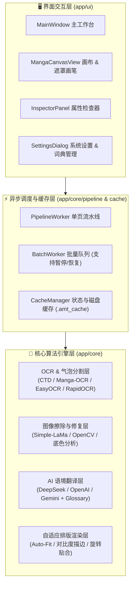

# 📐 项目技术架构与核心模块规范 (PROJECT.md)

本文档说明 **AetherLens (Automatic-Manga-Translation)** 的核心架构分层、关键技术特性与模块接口契约。

---

## 1. 核心架构分层 (Architecture Layers)

### 1.1 检测与气泡防粘连分割层 (`app/core/ocr/`)
- **`ctd_engine.py`**：基于 Comic Text Detector (DBNet + 文本行聚类)，按垂直间距（`y_gap > 1.2 * avg_h`）与暗色边界屏障拆分相邻文本行。
- **`base.py`**：连通域气泡标记（`compute_bubble_labels`）、成对文本行合并判定（`can_merge_pair`）、质心射线暗边界采样（Ray-Casting Dark Boundary Barrier）及旋转向量共线性校验，防止紧邻气泡与斜体旁白误合并。

### 1.2 多引擎协同 OCR 与语种感知层 (`app/core/ocr/` & `desktop/core/ocr_engine.py`)
- **逐框语种路由**：自动探测页面与单框语种特征，日文竖排路由至 `Manga-OCR` / `RapidOCR`，英文及拉丁语系路由至 `EasyOCR`，消除假名幻觉。
- **2D 空间片段排序与倾斜矫正**：对倾斜文本块进行仿射变换端正裁剪（Upright Crop Normalization），并按阅读顺序排序后拼接。

### 1.3 图像修复与掩码生成层 (`app/core/inpaint/`)
- **`lama_engine.py` & `opencv_engine.py`**：精细化生成膨胀文字掩码，消除边缘残影。
- **`color_analyzer.py`**：分析气泡背景色均值与标准差；针对反白/纯黑叙事框（`lum < 40`）直接采用背景中值纯色填充，跳过高斯羽化，杜绝灰白光晕。
- **`unboxed_text_eraser.py`**：针对漫画背景上的无框字、拟声词及手绘涂抹区域进行定向擦除。

### 1.4 语境感知翻译与专有名词词典 (`app/core/translation/`)
- **阅读序与分块上下文链**：支持日漫（右至左 `manga_rtl`）与条漫（左至右 `webtoon_ltr`）空间拓扑排序，跨批次传递前文摘要。
- **专有名词词典 (`glossary`)**：在提示词构建与后处理阶段注入用户自定义词条，保证角色名与核心术语前后统一。

### 1.5 智能排版与描边渲染层 (`app/core/typography/`)
- **`auto_fit.py`**：结合气泡安全内边距进行二分字号搜索与多行断词优化。
- **`engine.py` & `stroke_renderer.py`**：支持根据背景明暗自动反转字色与描边色（深色背景自动切换 `#FFFFFF` 白字与深色描边），支持自适应行距（`auto_line_spacing`）与动态描边宽度（`auto_stroke_width`）。

---

## 2. 核心特性清单 (Feature Inventory)

| 编号 | 特性名称 | 核心实现模块 | 状态 |
| :--- | :--- | :--- | :--- |
| **F1** | CTD 空间间距与暗边界文本行切分 | `app/core/ocr/ctd_engine.py` | ✅ 已完成 |
| **F2** | 气泡连通域精细化标记（防全页粘连） | `app/core/ocr/base.py` | ✅ 已完成 |
| **F3** | 质心射线暗色边界屏障检测 (Ray-Casting) | `app/core/ocr/base.py` | ✅ 已完成 |
| **F4** | 斜体手写旁白角度门控与边界保护 | `app/core/ocr/base.py` | ✅ 已完成 |
| **F5** | 逐框语种预判与日英双引擎协同路由 | `desktop/core/ocr_engine.py` | ✅ 已完成 |
| **F6** | EasyOCR 2D 空间拓扑排序 | `app/core/ocr/easyocr_engine.py` | ✅ 已完成 |
| **F7** | 倾斜文本框仿射旋转端正裁剪 | `app/core/ocr/easyocr_engine.py` | ✅ 已完成 |
| **F8** | 翻译上下文链、孤立标点过滤与专有名词词典 | `app/core/settings` / `translation` | ✅ 已完成 |
| **F9** | 宽幅叙事横幅与拟声词分类去偏 | `desktop/core/ocr_engine.py` | ✅ 已完成 |
| **F10** | 深色/黑底文本框纯色直填（无灰边残影） | `app/core/inpaint/opencv_engine.py` | ✅ 已完成 |
| **F11** | 底色感知高对比排版与动态行距/描边 | `app/core/typography/engine.py` | ✅ 已完成 |
| **F12** | 交互式涂抹重绘画笔、ZIP/CBZ 导入与批量暂停恢复 | `app/ui/canvas/view.py` / `main_window.py` | ✅ 已完成 |
| **F13** | 334 项核心单元测试零回归保障 | `tests/unit/` | ✅ 已完成 |

---

## 3. 关键接口契约 (Interface Contracts)

### 3.1 气泡分割与合并契约
- `ctd_engine.py::_cluster_lines_by_angle(lines, img=None)`：当相邻行垂直间距 `y_gap > max(20, 1.2 * avg_h)` 或穿越暗色边界像素（`I < 90`）时，强制拆分为独立文本块。
- `app/core/ocr/base.py::can_merge_pair(box1, box2, ...)`：若两框质心连线穿过暗色气泡框线，或旋转角偏差超出阈值且不满足向量共线性，返回 `False`。

### 3.2 背景修复与排版色彩契约
- `app/core/inpaint/`：当检测到均匀深色背景框（`block.bg_color == "#000000"` 或亮度 `lum < 40`）时，直接采用背景中值纯色覆盖文字掩码，跳过高斯 Alpha 混合。
- `app/core/typography/engine.py`：若 `block.bg_color` 为深色（`lum < 60`）且处于自动配色模式，自动采用 `#FFFFFF` 白色字体的高对比度渲染方案。
