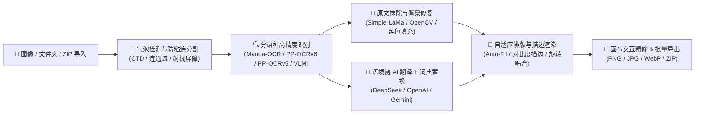

# 🌌 AetherLens (Automatic Manga Translation)

> **原生桌面级 AI 漫画自动嵌字与翻译工作台** —— 融合多引擎协同 OCR、深度学习背景擦除、大语言模型语境翻译与自适应排版引擎的现代化 PyQt6 客户端。

---

## 📖 目录

- [核心特性](#-核心特性)
- [技术架构与处理管线](#-技术架构与处理管线)
- [快速开始](#-快速开始)
- [配置与使用指南](#-配置与使用指南)
- [交互工具与快捷键速查](#-交互工具与快捷键速查)
- [项目目录结构](#-项目目录结构)
- [测试与质量保障](#-测试与质量保障)

---

## ✨ 核心特性

### 1. 🔍 多引擎协同 OCR 与防粘连分割
- **分语种高精度识别路由**：内嵌 **Comic Text Detector (CTD)** 检测与纯 PyTorch CUDA 分语种识别体系（日文 **Manga-OCR** / 英文 **PP-OCRv6** / 简繁中文 **PP-OCRv5 Server** / 韩文 **PP-OCRv5**），可选开启 **VLM 多模态低置信度兜底** 与 **PaddleOCR (v5/v3) / EasyOCR**。
- **多气泡防粘连算法**：采用连通域气泡标记与质心射线暗边界检测（Ray-Casting Barrier），精准分离紧邻对话气泡与斜体旁白注记，拒绝跨框误合并。
- **二维码与非文本免疫**：自动检测并保护画面中的二维码与装饰图形，防止误识别与误擦除。

### 2. 🧹 深度学习图像修复 (Inpainting)
- **双引擎擦除**：支持 **Simple-LaMa** 大模型纹理补全与 **OpenCV (Telea / NS)** 快速修复，自动消除复杂网点与彩色背景上的原文字迹。
- **深色/反白框纯净填充**：智能识别黑色或深色叙事框，直接以背景中值纯色填充，彻底消除高斯羽化导致的灰白残影。
- **无框文字抹除与交互画笔**：支持标题/拟声词无框文字智能擦除，并提供**局部重绘画笔（Brush Mask）**供手动精细修补。

### 3. 🤖 上下文感知 AI 翻译与专有名词词典
- **多模型无缝接入**：支持 **DeepSeek**、**OpenAI (GPT-4o / mini)**、**Google Gemini** 及任意兼容 OpenAI 接口的本地/第三方大模型，支持一键连通性测试。
- **漫画阅读序与语境链**：自动按照日漫右起（RTL）或美漫/条漫左起（LTR）顺序排列气泡，跨分块传递上下文，保持角色口吻一致。
- **📖 专有名词词典 (Glossary)**：内置术语词典管理面板，支持角色名、招式名、特定设定词的强制译名映射与全局持久化。

### 4. 📝 智能自适应排版引擎 (Typography)
- **气泡轮廓字号自适应**：基于气泡安全内边距自动计算最佳字号（`auto_fit_font_size`）与折行策略，告别文字溢出或拥挤。
- **动态行距与对比度描边**：支持自适应行距（`auto_line_spacing`）与随字号缩放的描边宽度（`auto_stroke_width`）；根据气泡底色亮度自动切换黑白高对比文字与描边。
- **多字体与横竖排切换**：内置霞鹜文楷、得意黑等开源字体，支持单气泡独立横竖排切换、旋转角度跟随与对齐微调。

### 5. 🖥️ 现代桌面交互工作台与批量流水线
- **多元视口对比**：支持 **译图预览**、**卷帘滑块对比 (Split Slider)**、**双联并排对比 (Side-by-Side)**、**原图** 与 **纯净抹字底图** 5 种视图一键切换。
- **就地精修与历史栈**：双击气泡即可唤出画布内联编辑器，配合右侧属性检查器实时重绘；支持完整的 `Ctrl+Z / Ctrl+Y` 撤销重做栈。
- **ZIP/CBZ 归档导入与层级导出**：支持直接拖入单图、多级章节目录或 `.zip/.cbz` 漫画压缩包；支持后台异步批量队列（可暂停/继续/跳过已译）及 WebP 视觉无损压缩导出。

---

## 🏗️ 技术架构与处理管线



---

## 🚀 快速开始

### 环境要求
- **操作系统**：Windows 10 / 11（推荐），macOS 或 Linux
- **Python 版本**：Python 3.10 ~ 3.12
- **硬件加速**：推荐配备 NVIDIA 显卡（支持 CUDA 加速 OCR 与 LaMa 修复；无独立显卡时自动回退至 CPU 模式）

### 启动方式

#### 方式 1：Windows 一键启动（推荐）
直接双击运行项目根目录下的 **`start_desktop.bat`**，脚本会自动检测虚拟环境并拉起桌面客户端。

#### 方式 2：命令行启动
```bash
# 安装依赖（首次运行）
pip install PyQt6 opencv-python numpy Pillow requests openai easyocr manga-ocr simple-lama-inpainting

# 启动现代工作台主程序
python -m app.main

# 或启动经典桌面端入口
python run_desktop.py
```

---

## ⚙️ 配置与使用指南

1. **配置翻译大模型**：
   - 点击界面左下角或顶栏 **「⚙️ 设置」** -> **「🤖 AI 翻译大模型」**。
   - 选择服务商（如 `DeepSeek`、`OpenAI` 或 `自定义兼容接口`），填入 API Key 与模型名称（如 `deepseek-chat`），可点击 **「测试连接」** 验证可用性。
2. **调整识别与修复策略**：
   - **「🔍 OCR 文字识别」**：可指定源语言（自动检测 / 日语 / 英语 / 韩语 / 中文）并开启 GPU 加速。
   - **「🧹 图像背景修复」**：选择 `LaMa 深度学习修复`（画质最佳）或 `OpenCV 快速修复`（速度优先），以及拟声词处理模式。
3. **设置排版样式与词典**：
   - **「📝 译文文字设置」**：配置默认字体（如霞鹜文楷）、字号自适应范围、描边模式与阅读方向（日漫右起 / 条漫左起）。
   - **「📖 专有名词词典」**：添加 `原文 -> 译文` 词条，翻译时将自动遵循词典设定。
4. **翻译与导出**：
   - 拖入图片、文件夹或 `.zip/.cbz` 压缩包。
   - 点击 **「翻译当前页」** 或左侧栏 **「批量翻译未完成页 / 全部重译」**。
   - 校对完成后，点击 **「导出」** 可输出单页图片、整章目录或打包 ZIP（支持勾选 WebP 视觉无损压缩）。

---

## ⌨️ 交互工具与快捷键速查

在软件内按 **`?`** 或 **`F1`** 可随时呼出快捷键面板：

| 类别 | 快捷键 / 操作 | 功能说明 |
| :--- | :--- | :--- |
| **视图与缩放** | `1` ~ `5` | 切换视图模式（`1` 译图 / `2` 卷帘对比 / `3` 双联对比 / `4` 原图 / `5` 抹字底图） |
| | `Ctrl + B` | 展开 / 折叠左侧页面导航栏 |
| | `Ctrl + 0` / `Ctrl + 1` | 缩放适应窗口 (Fit) / 1:1 原始像素比例 |
| | `空格 + 左键拖拽` / `中键拖拽` | 平滑漫游拖动画面 |
| **翻页与阅读** | `A` / `PageUp` | 翻至上一页 |
| | `D` / `PageDown` | 翻至下一页 |
| **气泡校对与新建** | `双击气泡` | 就地弹出浮动文本编辑框 |
| | `Tab` / `Shift + Tab` | 在当前页各气泡间顺次切换选中 |
| | `Ctrl + Enter` | 提交当前译文修改并自动跳转至下一气泡 |
| | `R` | 开启/退出 **手动划框新建空白气泡** 模式 |
| | `O` | 开启/退出 **手动划框并即时 OCR 翻译** 模式 |
| | `画笔工具 (Brush)` | 手动涂抹残留字迹区域并触发局部背景重绘 |
| **排版与历史** | `[` / `]` | 快速减小 / 增大当前选中气泡的字号 |
| | `V` | 一键切换选中气泡 **横排 ↔ 竖排** |
| | `Ctrl + Z` / `Ctrl + Y` | 撤销 (Undo) / 重做 (Redo) 操作 |

---

## 📁 项目目录结构

```text
Automatic-Manga-Translation/
├── app/                            # 现代 PyQt6 工作台核心应用
│   ├── core/                       # 核心算法与管线层
│   │   ├── cache/                  # 页面状态与磁盘缓存管理 (.amt_cache)
│   │   ├── inpaint/                # 图像修复引擎 (LaMa、OpenCV、底色分析、无框字抹除)
│   │   ├── ocr/                    # 文本检测与识别 (CTD、Manga-OCR、EasyOCR、RapidOCR、防粘连算法)
│   │   ├── pipeline/               # 单页与批量异步工作线程、队列暂停/恢复、阅读序工具
│   │   ├── translation/            # 多模型 LLM 客户端、上下文分块与词典注入
│   │   ├── typography/             # 智能排版引擎 (字号自适应、旋转贴合、对比度描边渲染)
│   │   ├── config.py               # 全局配置序列化与迁移
│   │   ├── hardware.py             # GPU / CUDA 硬件探测与 DLL 预加载
│   │   └── models.py               # 核心数据模型 (TranslationBlock, PageData, StyleConfig)
│   ├── ui/                         # 苹果 HIG 极简美学界面层
│   │   ├── canvas/                 # 60FPS 高刷画布、气泡图元、卷帘对比与涂抹画笔交互
│   │   ├── inspector/              # 右侧气泡属性检查器面板
│   │   ├── settings/               # 系统偏好设置弹窗与页面样式弹窗
│   │   ├── sidebar/                # 左侧导航轨、页面缩略图列表与拖拽导入区
│   │   ├── theme/                  # 明暗双主题设计 Token、QSS 样式表与矢量图标
│   │   └── widgets/                # 浮动内联编辑器、进度胶囊、快捷键面板等组件
│   └── main.py                     # 应用启动主入口
├── desktop/                        # 经典桌面核心模块与兼容层
├── assets/
│   └── fonts/                      # 内置开源中文字体 (霞鹜文楷、得意黑等)
├── tests/                          # 4 层自动化测试体系
│   ├── unit/                       # 334 项核心算法与 UI 单元测试
│   ├── e2e/                        # 端到端集成测试与真实漫画基准测试套件
│   └── challenge/                  # 极端分辨率与异常输入压力测试
├── desktop_config.json             # 默认运行时配置文件
├── run_desktop.py                  # 桌面客户端快捷启动脚本
└── start_desktop.bat               # Windows 一键启动批处理脚本
```

---

## 🧪 测试与质量保障

本项目配备完整的单元测试与端到端基准测试（详见 [`PROJECT.md`](PROJECT.md) 与 [`TEST_INFRA.md`](TEST_INFRA.md)）：

```bash
# 运行全部核心单元测试 (334 项测试)
pytest tests/unit/ -q

# 运行排版设置专项测试
pytest tests/test_typography_settings.py -v

# 运行压力与边缘场景测试
pytest tests/challenge/ -v
```
